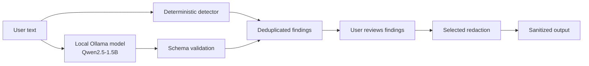

# SafeShare AI 🛡️

**Inspect before you share — a local-first privacy scanner for text.**

SafeShare AI helps developers, students, and support teams catch sensitive
information in text *before* it is pasted into a public issue, chat, or forum.
It combines a deterministic pattern scanner with contextual analysis from a
**local** Qwen2.5-1.5B model served by [Ollama](https://ollama.com/), then lets
you selectively redact what it finds. Your text is processed on your own
machine — there is no hosted AI provider in the loop.

> Built for **Hacktoberfest Islamabad 2026** · Domain: Developer & Open Source
> (with Business & Productivity relevance).

---

## Problem statement

People routinely paste logs, stack traces, config snippets, and support
messages into public channels. These often contain emails, IP addresses, API
tokens, private keys, or personal details that should not be shared. Existing
"scrubbers" are either pure regex (missing contextual leaks) or cloud services
(which means sending the sensitive text to a third party — the very thing you
are trying to avoid). SafeShare AI keeps analysis local.

## Intended users

- Developers filing bug reports or sharing logs
- Students and open-source contributors posting code snippets
- Support teams sanitizing customer messages
- Anyone pasting technical text into a public place

## Features

- **Deterministic detection** of emails, IPv4 addresses, phone numbers (conservative), API keys/tokens (AWS, GitHub, Slack, Google, Stripe), PEM private-key headers, and config-style secret assignments.
- **Contextual AI analysis** via a local Qwen2.5-1.5B model for risks regexes miss (implied identities, confidential internal details, narrative customer info).
- **Strict output validation** — every AI finding is checked for valid JSON, categories, severities, numeric offsets, offset ranges, and evidence consistency before it can touch your text.
- **Selective redaction** with category-specific placeholders, right-to-left application, and deterministic overlap resolution so output never gets corrupted.
- **Prompt-injection awareness** — pasted text is treated as untrusted data, not instructions.
- **Privacy-first UX** — local processing, loopback-endpoint warning, no telemetry, no persistence.
- **Graceful degradation** — deterministic scanning keeps working when Ollama is down.
- **Secure uploads** — 10 MB in-memory extraction for text/config/code, PDF, and DOCX;
  uploaded code is never executed and extraction failures are explicit.

## What makes this original

This is not a renamed tutorial. The deterministic engine, the structured-output
schema and validation layer, the dedup/overlap resolution, the right-to-left
redaction engine, the prompt-injection-resistant prompt, and the Streamlit
workflow are all implemented here from first principles. The AI is used for the
part it is actually good at — *contextual* judgment — while deterministic code
handles the parts that must be reliable.

## Why AI is central

A small local LLM contributes the contextual layer that pattern matching cannot:
spotting that a narrative identifies a specific person, that an internal project
codename is confidential, or that a combination of ordinary details is
identifying. The deterministic engine and the model are complementary; neither
alone covers the problem.

---

## Model, runtime, and license

| Item | Value |
|------|-------|
| Model | **Qwen2.5-1.5B-Instruct** |
| Approx. parameters | **~1.5 billion** (below the 8B event limit) |
| Model license | **Apache License 2.0** |
| Official model card | https://huggingface.co/Qwen/Qwen2.5-1.5B-Instruct |
| Runtime | **Ollama**, local HTTP API only (`http://localhost:11434`) |
| Ollama tag (tested) | **`qwen2.5:1.5b`** |
| Ollama instruct alias | `qwen2.5:1.5b-instruct` (same instruct-tuned model) |

**Verification notes (performed on the dev machine):**
- `ollama show qwen2.5:1.5b` reports architecture `qwen2`, `parameters 1.5B`,
  context length `32768`, and license `Apache License 2.0`.
- The Ollama `qwen2.5` library tags are the instruct-tuned variants of
  Qwen2.5. The explicit `qwen2.5:1.5b-instruct` tag also exists in the Ollama
  library and resolves to the same model.
- The project's **code** is MIT-licensed; the **model** is Apache-2.0. These are
  different licenses and are acknowledged separately.

---

## Architecture & data flow

```
safeshare-ai/
├── app.py                 # Streamlit UI and workflow
├── requirements.txt
├── README.md
├── LICENSE                # MIT (project code)
├── .env.example
├── .gitignore
├── pytest.ini
├── src/
│   ├── __init__.py
│   ├── detectors.py       # deterministic pattern detection
│   ├── ai_analyzer.py     # contextual AI analysis + response normalization
│   ├── redactor.py        # validated, deterministic redaction
│   ├── schemas.py         # finding schema, validation, dedup, severity
│   ├── document_loader.py # bounded in-memory text/PDF/DOCX extraction
│   └── ollama_client.py   # local Ollama connectivity + error handling
├── tests/                 # pytest suite (no live model required)
├── scripts/
│   └── live_smoke.py      # optional manual live-model check
└── .streamlit/
    └── config.toml
```



The deterministic detector and the local model both feed findings; AI findings
pass through schema validation first; results are deduplicated; the user chooses
what to redact; redaction produces the sanitized output.

---

## System requirements

- Python 3.10+ (developed and tested on Python 3.14)
- [Ollama](https://ollama.com/) installed and running locally
- ~1 GB disk for the quantized model
- Internet access **once**, to install Python deps and pull the model. After
  that, inference runs locally. (This project does not claim to be fully
  offline — initial setup needs the network.)

## Setup

### 1. Install Ollama and pull the model

Install Ollama from https://ollama.com/, then:

```bash
ollama pull qwen2.5:1.5b
ollama serve        # if not already running as a service
```

Ollama downloads the model files on first pull; this step needs the internet.

### 2. Python environment

```bash
python -m venv .venv
# Windows
.venv\Scripts\activate
# macOS / Linux
source .venv/bin/activate

pip install -r requirements.txt
```

### 3. Configure (optional)

```bash
cp .env.example .env     # Windows: copy .env.example .env
```

| Variable | Default | Meaning |
|----------|---------|---------|
| `OLLAMA_BASE_URL` | `http://localhost:11434` | Local Ollama endpoint. Keep on localhost. |
| `OLLAMA_MODEL` | `qwen2.5:1.5b` | Installed model tag. |
| `OLLAMA_TIMEOUT` | `120` | Per-request timeout (seconds). First call can be slow. |

### 4. Run

```bash
streamlit run app.py
```

Then open http://localhost:8501.

### 5. Tests

```bash
pytest
```

The suite runs **without** a live Ollama server or model download — all HTTP
and model boundaries are mocked.

Optional live check (requires Ollama + model):

```bash
# from the project root
python scripts/live_smoke.py
```

---

## Example

**Input (synthetic):**

```
Contact dev-example@example.com about the deployment issue. The example
configuration contains API_TOKEN=EXAMPLE_NOT_A_REAL_TOKEN. The staging
server is 192.0.2.10.
```

**Deterministic findings:** email, config secret assignment, IPv4 address.
**AI:** adds a short contextual summary of the risk.

**After selecting all and redacting:**

```
Contact [REDACTED_EMAIL] about the deployment issue. The example
configuration contains API_TOKEN=[REDACTED_SECRET]. The staging
server is [REDACTED_IP].
```

Always review the sanitized text yourself before sharing.

---

## Privacy & data handling

- Text is sent **only** to your locally configured Ollama service for the AI step.
- No hosted inference, no OpenRouter, no cloud fallback, no telemetry.
- No database persistence; nothing is written to disk by the app.
- The submitted text is never written to application logs, and raw sensitive
  values are never placed in error messages.
- The UI warns if `OLLAMA_BASE_URL` is not a loopback address, because that
  would send your text off the machine.

This does **not** guarantee privacy or that every sensitive value is caught.

## Known limitations

- A 1.5B model may miss subtle contextual risks or flag harmless text.
- Prompt-injection resistance is improved (untrusted-data framing + strict
  validation) but **not** solved. Treat it as defense-in-depth, not a guarantee.
- Deterministic patterns are conservative and will not catch every secret format.
- Phone-number detection is intentionally cautious and may miss unusual formats.
- Redaction only covers detected spans; the result is not guaranteed clean.

## Acknowledgements

- **Qwen2.5-1.5B-Instruct** by Alibaba Cloud — Apache 2.0 ([model card](https://huggingface.co/Qwen/Qwen2.5-1.5B-Instruct)).
- **Ollama** — local model runtime.
- **Streamlit** — UI framework.
- **requests**, **python-dotenv**, **pytest** — supporting libraries.

Each dependency and the model are under their own licenses and terms. The
project code is MIT; the model is Apache-2.0 — they are not the same license.

## Demo walkthrough

1. Start Ollama and launch the app.
2. The status panel shows service reachable, model tag, and installed status.
3. Pick a synthetic sample from the dropdown or paste your own.
4. Click **Analyze** — deterministic + AI findings appear with sources.
5. Toggle which findings to redact.
6. Review the sanitized output, then copy it.
7. Click **Reset** to clear.

## Future improvements

- Streaming AI responses for faster perceived latency.
- More provider credential patterns and entropy-based secret heuristics.
- Inline highlighting of findings in the original text.
- Export of a redaction report (sanitized text only).

## License

MIT — see [LICENSE](LICENSE). The Qwen2.5 model is licensed separately under
Apache 2.0.
